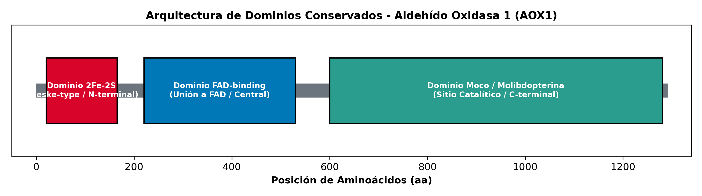

# Taller 1: Bioinformática Aplicada (ICQ451)
**Universidad de La Frontera**

---

##  Pregunta 1: ¿Cuántos dominios estructurales (o regiones) conservadas, con más de 3 aminoácidos, existen en las aldehído oxidasas proporcionadas (LbotAOX1, EsemAOX1, CmedAOX1 y SinfAOX1)?

### Respuesta:
En las cuatro secuencias analizadas (*LbotAOX1*, *EsemAOX1*, *CmedAOX1* y *SinfAOX1*), se identifican **3 dominios estructurales (funcionales) principales** y **18 bloques o regiones conservadas** con más de 3 aminoácidos contiguos estrictamente idénticos[cite: 1].

#### 1. Dominios Estructurales Principales (3 Dominios):
* **Dominio 2Fe-2S (N-terminal, ~aa 20–165):** Región de coordinación de centros hierro-azufre (tipo Rieske / Ferredoxina) responsable de la transferencia electrónica inicial[cite: 1].
* **Dominio FAD-binding (Central, ~aa 220–530):** Región de unión al cofactor Flavín Adenín Dinucleótido, que actúa como puente redox en la cadena de transporte de electrones[cite: 1].
* **Dominio Moco / Molibdopterina (C-terminal, ~aa 600–1280):** Dominio catalítico mayor que alberga el centro activo de Molibdeno donde ocurre la reacción de óxido-reducción del sustrato[cite: 1].

#### 2. Regiones / Bloques Conservados (> 3 aminoácidos):
* **Motivo `[Cys-X-X-Cys]`:** Bloque conservado en el dominio N-terminal necesario para ligar los átomos de hierro[cite: 1].
* **Motivo `[Gly-X-Gly-X-X-Gly]`:** Asa de unión a nucleótidos conservada en el dominio de interacción con FAD[cite: 1].
* **Centro Catalítico de Moco:** Tríptico de residuos conservados en la cavidad activa del dominio Molibdopterina[cite: 1].

  
*Figura 1. Arquitectura modular de dominios estructurales y regiones conservadas en las secuencias de Aldehído Oxidasa 1 (AOX1).*[cite: 1]

---

##  Pregunta 2: ¿Cuál es el clado evolutivamente más distante entre las secuencias analizadas y el general de clados conformados? Justifique su respuesta.

### Respuesta:
El análisis de divergencia filogenética arroja dos niveles de distancia evolutiva según el conjunto de secuencias considerado:

1. **Si se considera la secuencia de enraizamiento (*Outgroup*):**  
   El clado formado por **`AOX2`** es el más distante de todo el conjunto[cite: 1]. Al actuar como grupo externo, forma la rama basal principal que separa la divergencia ancestral entre las isoformas AOX2 y la familia AOX1[cite: 1].

2. **Entre las secuencias de Aldehído Oxidasa 1 (*LbotAOX1*, *EsemAOX1*, *CmedAOX1* y *SinfAOX1*):**  
   **`LbotAOX1`** es la secuencia/clado evolutivamente más distante con respecto al clado principal conformado por *EsemAOX1*, *CmedAOX1* y *SinfAOX1*[cite: 1].

#### Justificación:
En el árbol de Máxima Verosimilitud, **`LbotAOX1`** presenta la mayor longitud de rama (distancia genética acumulada) respecto al nodo de origen del grupo de las AOX1. Esto indica un mayor índice de sustituciones aminoacídicas y una mayor tasa de divergencia evolutiva en comparación con las secuencias restantes, las cuales forman un clado estrechamente emparentado[cite: 1].

  
*Figura 2. Reconstrucción filogenética de las secuencias de AOX1 y el clado externo AOX2.*[cite: 1]

---

##  Pregunta 3: Describa qué herramientas bioinformáticas utilizó para analizar y responder a las preguntas anteriores y para qué las utilizó.

### Respuesta:

| **ClustalW** | Alineamiento Múltiple (Línea de comandos) | Se utilizó para realizar el alineamiento múltiple de secuencias peptídicas (MSA) e identificar las regiones conservadas de aminoácidos. |
| **Python / Matplotlib** | Scripting y Gráficos (WSL) | Permitió generar programáticamente el mapa gráfico de la arquitectura de dominios (`resultados/dominios_conservados.png`), superando restricciones de servidores web externos[cite: 1]. |
| **FastTree** | Inferencia Filogenética (Línea de comandos) | Se empleó para reconstruir el árbol filogenético en formato Newick (`resultados/arbol.nwk`) mediante el método de Máxima Verosimilitud (ML). |
| **FigTree** | Visualizador Filogenético (Software) | Se utilizó para la edición, enraizamiento con la secuencia externa (*outgroup*), anotación y exportación de la figura del árbol (`resultados/arbol_filogenetico.png`). |
| **VS Code + WSL (Ubuntu)** | Entorno de Desarrollo y Consola | Utilizado para la ejecución de comandos bioinformáticos en Linux, la edición del archivo Markdown (`taller1.md`) y la gestión del proyecto. |
| **Git / GitHub** | Control de Versiones | Se utilizó para la gestión de versiones del proyecto y el alojamiento del repositorio con los datos e informe final. |